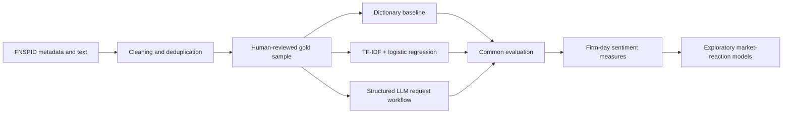
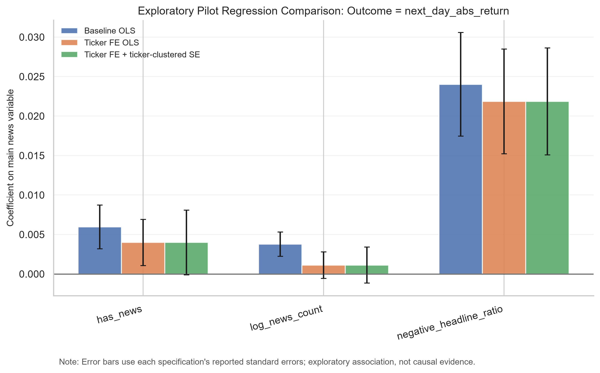

# Financial News Sentiment Lab

A reproducible NLP and empirical-finance workflow for comparing transparent sentiment methods and exploring short-term market reactions.

> This is a research and portfolio project, not a trading system. Results are exploratory associations and do not establish causality or investment performance.

## Research question

How do dictionary measures, a TF-IDF logistic-regression baseline and structured LLM labels differ when they are evaluated against the same human-reviewed financial-news sample?

## Pipeline



## What is complete

- Unified text schema with explicit source and provenance fields.
- A 300-row manually reviewed sample across positive, neutral and negative labels.
- Chronological train/test split to reduce same-event leakage.
- TF-IDF plus logistic-regression baseline.
- Accuracy, Macro-F1, class-level metrics, confusion matrix and predictions.
- Firm-day aggregation and exploratory market-reaction scripts.
- Structured zero-shot/few-shot LLM request preparation and output-schema validation.

## Current baseline result

The final held-out test contains 55 rows.

| Metric | Result |
|---|---:|
| Accuracy | 0.564 |
| Macro-F1 | 0.538 |
| Weighted-F1 | 0.566 |

The score is intentionally reported without inflation. Neutral headlines were easier for the baseline than positive or negative headlines; the next step is error analysis and comparison against additional text models.



## LLM status

The repository contains an auditable LLM workflow, but it does **not** claim a completed LLM benchmark:

- `prepare_llm_sentiment_requests.py` creates versioned JSONL records.
- `validate_llm_outputs.py` checks JSON parsing and allowed labels.
- A provider/model run, saved raw outputs and error analysis are still required before reporting LLM performance.

This distinction is deliberate: prepared infrastructure is not presented as an evaluated result.

## Reproduce the workflow

```bash
python -m venv .venv
# Windows
.venv\Scripts\activate
pip install -r requirements.txt
```

Download the source dataset separately, following [DATA_SOURCES.md](DATA_SOURCES.md). Raw news and price data are intentionally excluded from this repository.

The numbered folders under `scripts/` show the intended sequence:

```text
01_web_collection/
02_data_cleaning/
03_annotation/
04_dictionary/
05_machine_learning/
06_llm/
```

Most scripts expose explicit paths through command-line arguments. Run `python <script> --help` before execution.

## Methodological controls

- Preserve source labels and content hashes.
- Use conservative next-trading-day mapping.
- Avoid random leakage across near-duplicate or same-event records.
- Select text measures using the human-reviewed sample, not market significance.
- Keep exploratory association language separate from causal claims.
- Preserve model, prompt, run date and raw-output metadata for any LLM run.

See [methodology](docs/methodology.md) and [annotation guideline](docs/annotation_guideline.md).

## Data and licensing

This repository contains code, aggregate metrics and figures only. It does not redistribute the full FNSPID dataset or publisher article text. FNSPID is distributed separately under CC BY-NC 4.0; see [DATA_SOURCES.md](DATA_SOURCES.md) for attribution and boundaries.

The code authored for this project is available under the MIT License. Third-party datasets remain under their original terms.

## Author

Yilin Yang - International Accounting master's student at City University of Hong Kong, exploring reliable financial NLP, data quality and evidence-based reporting.
